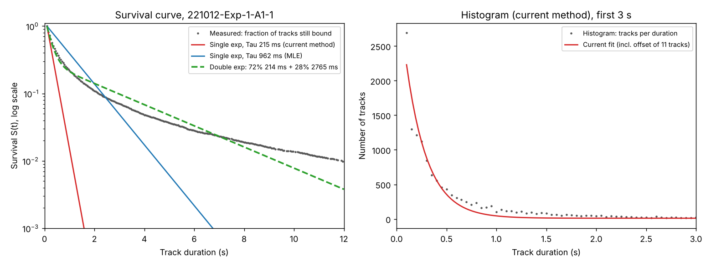

# Analysis: track duration distribution and the Tau fit

Date: 2026-11-06
Data: experiment `221012` (Paint Test Project), recordings A1-1, A1-2, A1-3, all tracks of the
whole image (1x1 grid), 42 981 tracks in total.
Related: `Change Note - Survival Curve Tau.md`.

## 1. Question

Tau is currently obtained by fitting an exponential to a **histogram** of track durations. It has
been suggested that fitting a **survival curve** would be more robust. Before changing anything,
this analysis looks at what the actual track durations look like, and what each method gives.

## 2. Background: histogram and survival curve

If unbinding is a single memoryless process (constant probability per unit time, rate
k_off = 1/τ), track durations are exponentially distributed. The same exponential can be fitted
in two forms:

- **Histogram (density):** the number of tracks ending around time t, p(t) ∝ e^(−t/τ).
- **Survival curve:** the fraction of tracks lasting longer than t, S(t) = e^(−t/τ). It starts at 1
  and falls to 0, uses every track as measured without bins, and stays smooth in the tail.

On a **log scale** a single exponential is a **straight line** on the survival curve, with
slope −1/τ. A bend means more than one population: for example short non-specific and longer
specific binding, which need a double exponential
S(t) = A·e^(−t/τ₁) + (1 − A)·e^(−t/τ₂).

### 2.1 How the survival curve is built

For every time t: **what fraction of tracks lasts at least t?** Imagine all tracks starting at the
same moment, and count how many are still "alive" as time passes.

Example with 10 tracks, durations in seconds:
`0.10, 0.10, 0.15, 0.20, 0.20, 0.20, 0.35, 0.60, 1.20, 3.00`

1. Sort the durations from short to long.
2. For each distinct duration t, count the tracks with duration ≥ t and divide by the total (10):

| t (s) | Tracks with duration ≥ t | S(t) |
|---|---|---|
| 0.10 | 10 | 1.0 |
| 0.15 | 8 | 0.8 |
| 0.20 | 7 | 0.7 |
| 0.35 | 4 | 0.4 |
| 0.60 | 3 | 0.3 |
| 1.20 | 2 | 0.2 |
| 3.00 | 1 | 0.1 |

3. The result is a staircase: it starts at 1 at the shortest track and drops each time tracks end.
   The drop at a given t is the share of tracks that end exactly there (at 0.20 s: three tracks,
   so 0.3 down).

Nothing is grouped or binned: every track counts exactly once, at its own duration.

**For the data in this analysis:** per recording, all `Track Duration` values from `Tracks.csv`,
rounded to 3 decimals. Durations are whole frames of 0.05 s, so there are about 350–440
distinct values per recording. After sorting, track number i (counting from 0) has 1 − i/n of the
tracks at or beyond it; for each distinct value the first track with that value is taken. The first
point is always t = 0.1 s with S = 1, because 0.1 s is the shortest possible track (3 spots,
2 frame intervals).

**Relation to the histogram.** The histogram shows how many tracks *end* at each t, which is the
drop in each step of the staircase. Both contain the same information, but the histogram puts each
frame in its own bin, and in the tail those bins hold 0, 1 or 2 tracks, which is very noisy. The
survival curve accumulates all longer tracks at each point, so it stays smooth in the tail.

**Fitting.** The formula, with one or two exponentials, is fitted through the points (t, S(t)).
Alternatively Tau is estimated directly from the durations by maximum likelihood, which needs no
curve at all.

## 3. Method

For each recording, four estimates of Tau were computed from `Track Duration` in `Tracks.csv`:

1. **Current method**, reproduced exactly as in `CalculateTau`: the number of tracks per distinct
   duration (one bin per frame, since durations are whole frames of 0.05 s), fitted with
   `m·e^(−t/τ) + b` by unweighted least squares. This reproduces the Tau values in
   `Recordings.csv` (215, 232, 227 ms), so the comparison is like for like.
2. **Survival curve, single exponential:** least-squares fit of S(t) = e^(−(t − t_min)/τ).
   t_min = 0.1 s is the shortest possible track (3 spots, the minimum in the Fiji plugin).
3. **Maximum likelihood, single exponential:** τ = mean(duration − t_min), corrected for whole
   frames. This is the statistically best estimate if the data is a single exponential.
4. **Maximum likelihood, double exponential:** fraction A with τ₁, fraction 1 − A with τ₂.

The script is in the appendix.

## 4. Results

| Recording | Tracks | Current (histogram) | Survival, 1 exp | MLE, 1 exp | Double exp (MLE) |
|---|---|---|---|---|---|
| A1-1 | 14 583 | 215 ms (R² 0.949) | 566 ms (R² 0.894) | 962 ms | 72% **214 ms** + 28% 2765 ms |
| A1-2 | 13 417 | 232 ms (R² 0.952) | 639 ms (R² 0.877) | 1149 ms | 73% **250 ms** + 27% 3534 ms |
| A1-3 | 14 981 | 227 ms (R² 0.947) | 689 ms (R² 0.852) | 1292 ms | 73% **259 ms** + 27% 3999 ms |

Other numbers (A1-1 / A1-2 / A1-3):

- median duration 0.35 / 0.35 / 0.40 s, mean 1.04 / 1.22 / 1.37 s
- fraction of tracks longer than 1 s: 21% / 23% / 25%; longer than 5 s: 3.7% / 4.6% / 5.6%
- the offset `b` in the current fit: about 10 tracks per bin (11.0 / 9.7 / 10.0)



Left: survival curve on a log scale with the current Tau (red), the single-exponential MLE (blue)
and the double exponential (green, dashed). Right: the histogram with the current fit, first 3 s.

## 5. Findings

1. **The durations are not a single exponential.** On the log scale the survival curve is clearly
   bent: steep at first, then a long, slow tail. About **73% of tracks are short (≈210–260 ms)**
   and **about 27% are long (≈3–4 s)**. Beyond about 7 s, the tail is heavier still than the
   double exponential predicts.
2. **The current histogram fit effectively measures the fast population.** Its Tau
   (215 / 232 / 227 ms) is almost the same as the fast component of the double exponential
   (214 / 250 / 259 ms). The offset `b` absorbs the long tail. The current Tau is therefore
   consistent and meaningful, but it describes only the short binders and says nothing about the
   long ones.
3. **A single exponential on the survival curve would not be an improvement.** Depending on the
   fitting method it gives 566–1292 ms: an average of two populations that describes neither. It
   would also be 3–5 times the values published so far.
4. **The real question is one versus two exponentials, not histogram versus survival curve.** The
   survival curve is the right tool to see this, and to fit two components.
5. **R² on the survival curve.** `Change Note - Survival Curve Tau.md` (section 4.3) states that a
   least-squares fit on a survival curve almost always gives R² close to 1. That is overstated:
   here it is 0.85–0.89, lower than the histogram's 0.95, precisely because a single exponential
   does not fit. R² on a survival curve is inflated by the correlation between points, but it
   still responds to a wrong model.

## 6. Tau and k_off

For a single exponential, **k_off = 1/τ**, with τ the mean time a molecule stays bound. Because the
data contains two populations, this has to be applied per population. In s⁻¹, k_off = 1000 / Tau in ms.

| Recording | Current Tau | → k_off | Fast population | → k_off,1 | Slow population | → k_off,2 |
|---|---|---|---|---|---|---|
| A1-1 | 215 ms | 4.7 s⁻¹ | 72%, 214 ms | 4.7 s⁻¹ | 28%, 2.77 s | 0.36 s⁻¹ |
| A1-2 | 232 ms | 4.3 s⁻¹ | 73%, 250 ms | 4.0 s⁻¹ | 27%, 3.53 s | 0.28 s⁻¹ |
| A1-3 | 227 ms | 4.4 s⁻¹ | 73%, 259 ms | 3.9 s⁻¹ | 27%, 4.00 s | 0.25 s⁻¹ |

### 6.1 What each Tau means for k_off

1. **Current Tau (histogram): 1/τ ≈ k_off of the fast population.** It almost equals the fast
   component, so the k_off derived from it (≈ 4–5 s⁻¹) is the dissociation rate of the short
   binders, not an average over all binding events.
2. **Double exponential: two separate k_off values.** About 73% of binding events dissociate
   quickly (k_off ≈ 4 s⁻¹, about ¼ s bound) and about 27% slowly (k_off ≈ 0.25–0.36 s⁻¹, about
   3–4 s bound). They differ by a factor of 10–15.
3. **Single exponential on the survival curve, or MLE (566–1292 ms): 1/τ is not a real k_off.** It is
   an average over two populations, a rate that no molecule actually has. The single-exponential
   MLE is the mean duration over all tracks, and 1/mean is not a dissociation rate when the
   population is mixed.

### 6.2 What the fractions mean

The 73% / 27% are shares of **binding events** (tracks), not of bound molecules at any given
moment. Because slow binders stay bound much longer, they dominate the **time spent bound**:
0.27 × 2.8–4.0 s against 0.73 × 0.21–0.26 s, so about **83–85% of all bound time** comes from the
slow population. Biologically that may be the more interesting group, while the current Tau
describes the other one.

### 6.3 Apparent versus true binding time

Track duration is an **apparent** binding time. A track also ends when the dye bleaches, the
molecule leaves the focal plane, or tracking loses it. These add as rates:

1/τ_measured = 1/τ_binding + 1/τ_bleach (+ other losses)

- **Fast population** (≈ 0.2 s): the correction is small, as long as bleaching takes seconds or more.
- **Slow population** (≈ 3–4 s): the correction can be large. For example, if τ_bleach were 5 s, the
  true τ₂ for A1-1 would be 1/(1/2.77 − 1/5) ≈ 6.2 s instead of 2.77 s, and k_off,2 would be 0.16
  instead of 0.36 s⁻¹. τ_bleach is not known here. It would need a control measurement, for
  example dye bound to glass, or recordings at different frame intervals.
- The shift by the minimum track length (0.1 s) does not affect τ, because the process is memoryless.
- Whether the shortest tracks (0.1–0.3 s) are all real binding, or partly noise linked into short
  tracks, is not known. That would mainly affect the fast population.

## 7. Caveats

- One experiment only, three recordings.
- Whole image (1x1 grid): binding on the cell and non-specific binding on the glass are mixed.
  Per-square results may differ.
- The long component may partly reflect photobleaching, molecules leaving the focal plane, or
  tracking behaviour (gap closing), not only binding.
- The tracks predate the exclusion of edge tracks. Edge tracks are few and would mostly affect
  the far tail.
- **Track numbers per square.** A square often has only 20–100 tracks. That is enough for a single
  exponential, but a reliable double-exponential fit needs several hundred tracks. That is the main
  practical obstacle at square level.

## 8. Options (for Hans to decide)

- **(a) Keep the histogram method,** and record in the documentation that it effectively gives the
  Tau of the fast population.
- **(b) Add a double-exponential fit on the survival curve,** reporting Tau1, Tau2 and the fraction.
  More information, but only reliable at recording level or for squares with enough tracks.
- **(c) A single exponential on the survival curve.** Not recommended (finding 3).

Possible next steps before deciding:

- the same analysis on more experiments
- the same analysis per square on a normal grid, including how many squares have enough tracks for a
  double-exponential fit

## Appendix: script

Python 3 with pandas, numpy and scipy. Run with the path to an experiment's `Tracks.csv`.

```python
import sys
import numpy as np
import pandas as pd
from scipy.optimize import curve_fit, minimize

DT = 0.05                                   # frame interval (s)
tracks = pd.read_csv(sys.argv[1])

for rec, g in tracks.groupby("Recording Name"):
    d    = np.round(g["Track Duration"].values, 3)
    n    = len(d)
    tmin = d.min()

    # 1. Current method: tracks per distinct duration, fit m*exp(-k x) + b (unweighted)
    x, y = np.unique(d, return_counts=True)
    f    = lambda x, m, k, b: m * np.exp(-k * x) + b
    p, _ = curve_fit(f, x, y, p0=[y.max(), 1 / 0.3, 0], maxfev=20000)
    r2   = 1 - np.sum((y - f(x, *p)) ** 2) / np.sum((y - y.mean()) ** 2)

    # 2. Survival curve, single exponential, least squares
    ts      = np.sort(d)
    S       = 1 - np.arange(n) / n           # fraction with duration >= t
    xs, idx = np.unique(ts, return_index=True)
    Ss      = S[idx]
    g1      = lambda x, tau: np.exp(-(x - tmin) / tau)
    (tau_s,), _ = curve_fit(g1, xs, Ss, p0=[0.5])
    r2_s    = 1 - np.sum((Ss - g1(xs, tau_s)) ** 2) / np.sum((Ss - Ss.mean()) ** 2)

    # 3. Maximum likelihood, single exponential above tmin (whole-frame correction)
    m       = np.mean(d - tmin)
    tau_mle = -DT / np.log(m / (m + DT))

    # 4. Maximum likelihood, double exponential above tmin
    s = d - tmin
    def nll(v):
        a, t1, t2 = 1 / (1 + np.exp(-v[0])), np.exp(v[1]), np.exp(v[2])
        return -np.sum(np.log(a / t1 * np.exp(-s / t1) + (1 - a) / t2 * np.exp(-s / t2)))
    r  = minimize(nll, [0, np.log(0.15), np.log(3)], method="Nelder-Mead",
                  options={"maxiter": 5000, "xatol": 1e-6, "fatol": 1e-6})
    a  = 1 / (1 + np.exp(-r.x[0]))
    t1, t2 = np.exp(r.x[1]), np.exp(r.x[2])
    if t1 > t2:
        a, t1, t2 = 1 - a, t2, t1

    print(f"{rec}: n={n}")
    print(f"  current histogram : Tau={1000 / p[1]:.0f} ms  R2={r2:.3f}  b={p[2]:.1f}")
    print(f"  survival, 1 exp   : Tau={1000 * tau_s:.0f} ms  R2={r2_s:.3f}")
    print(f"  MLE, 1 exp        : Tau={1000 * tau_mle:.0f} ms")
    print(f"  MLE, 2 exp        : {100 * a:.0f}% {1000 * t1:.0f} ms + {100 * (1 - a):.0f}% {1000 * t2:.0f} ms")
```
